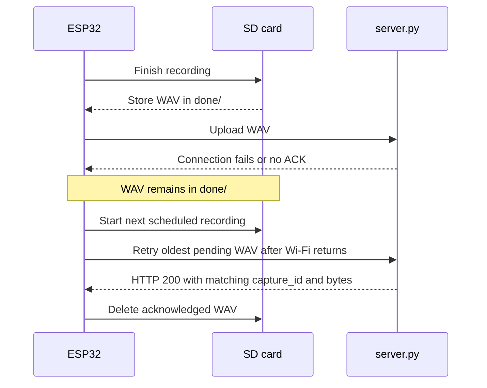

# Audio Recording Architecture and Flow

This document describes the audio firmware selected by:

```text
idf.py -D FIELD_FIRMWARE=audio build
```

## Architecture Diagram

```mermaid
flowchart LR
    MIC["I2S microphone"] --> I2S["I2S RX driver"]
    I2S --> CAP["capture_task\nCPU 1 / priority 10"]
    CAP --> FULL["q_full_blocks\nFreeRTOS queue"]
    FULL --> WRITE["writer_task\nCPU 0 / priority 6"]
    WRITE --> WAV["WAV file\n/sdcard/undone/*.wav"]
    FREE["q_free_blocks\nFreeRTOS queue"] --> CAP
    WRITE --> FREE
    WAV --> COMMIT["storage_finish_recording(true)\nrename undone -> done"]
    COMMIT --> DONE["/sdcard/done/*.wav"]
    DONE --> UPLOAD["upload_process_pending()"]
    UPLOAD --> HTTP["HTTP POST /upload/audio"]
    HTTP --> SERVER["server.py\nvalidate headers + WAV prefix\nstore file + ACK"]
    SERVER --> ACK["HTTP 200 ACK\nstatus + capture_id + bytes"]
    ACK --> DELETE["storage_delete_done()"]
    DELETE --> REMOVED["Delete local WAV"]
    HB["heartbeat_task\nevery 1 minute"] --> HEARTBEAT["HTTP POST /heartbeat"]
    HEARTBEAT --> SERVER
    WIFI["Wi-Fi state"] -. controls .-> UPLOAD
    WIFI -. controls .-> HB
```



## Recording and Upload Flow

```mermaid
flowchart TD
    START([Boot]) --> NVS["Initialize NVS"]
    NVS --> ID["Initialize device identity"]
    ID --> WIFI["Initialize Wi-Fi"]
    WIFI --> CLOCK["Synchronize clock via /time"]
    CLOCK --> REC_INIT["Initialize SD card and I2S"]
    REC_INIT --> HB["Start heartbeat task"]
    HB --> BACKLOG["Upload existing files in done/"]
    BACKLOG --> PERIOD["Wait for scheduled cycle"]
    PERIOD --> RESERVE["Reserve timestamped path in undone/"]
    RESERVE --> POOL["Initialize fixed audio block pool\n16 blocks x 1024 samples"]
    POOL --> TASKS["Start writer_task and capture_task"]
    TASKS --> CAPTURE["capture_task reads I2S\nconverts 32-bit input to 16-bit PCM"]
    CAPTURE --> QUEUE["Send full blocks to q_full_blocks"]
    QUEUE --> WRITE["writer_task applies gain\nand writes blocks to WAV"]
    WRITE --> END_CAPTURE{ "5 minutes complete?" }
    END_CAPTURE -- No --> CAPTURE
    END_CAPTURE -- Yes --> FINALIZE["Write final WAV header\nand close file"]
    FINALIZE --> SUCCESS{ "Capture and write successful?" }
    SUCCESS -- Yes --> COMMIT["Rename undone/ to done/"]
    SUCCESS -- No --> KEEP["Keep file in undone/\nfor failed/incomplete recording"]
    COMMIT --> CONNECTED{ "Wi-Fi connected?" }
    KEEP --> CONNECTED
    CONNECTED -- No --> RETAIN["Keep done file on SD card"]
    CONNECTED -- Yes --> UPLOAD["Find oldest file in done/"]
    RETAIN --> NEXT["Next cycle"]
    UPLOAD --> POST["POST WAV with device/capture/time/size headers"]
    POST --> SERVER{ "Server ACK valid?" }
    SERVER -- No --> RETRY["Keep file and retry later"]
    SERVER -- Yes --> REMOVE["Delete local done file"]
    RETRY --> NEXT
    REMOVE --> NEXT
    NEXT --> PERIOD
```

## Failure Recovery



## Important Implementation Notes

- The main schedule records for 5 minutes every 10 minutes.
- `capture_task` runs on CPU 1 and `writer_task` runs on CPU 0.
- The audio block pool contains 16 blocks, each containing 1024 mono samples.
- A completed recording is committed by renaming `undone/` to `done/`.
- A local file is deleted only after HTTP status 200 and ACK fields are validated.
- The current server checks the WAV prefix and declared size, but does not yet calculate whether the WAV duration is exactly 5 minutes.
- With 16 kHz, mono, 16-bit PCM and 300 seconds, the expected file size is approximately 9,600,044 bytes.
