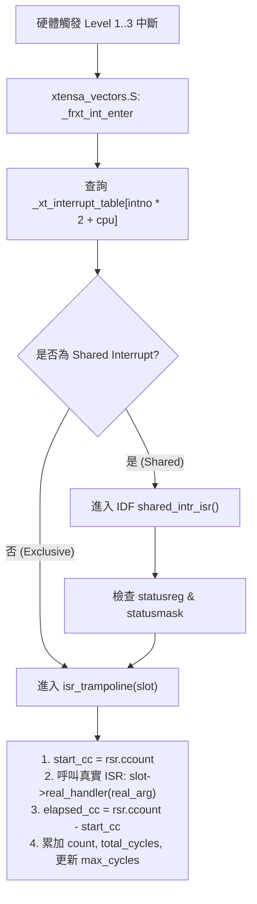

# C ISR 分派器攔截與各核心中斷負擔分析 (`isr_profile`)

本文件說明在不修改 ESP-IDF 原始碼的前提下，透過 Linker `--wrap` 機制攔截 Xtensa C 中斷分派器，精準統計 ESP32-S3 雙核心（Core 0 / Core 1）在「錄影（RECORD）」與「上傳（UPLOAD）」階段中，**每一個硬體中斷（ISR）的觸發次數、執行耗時與 CPU 負擔百分比（CPU Load %）**。

---

## 一、 新增與修改的檔案清單及用途

| 檔案路徑 | 變更類型 | 用途說明 |
| :--- | :--- | :--- |
| [`main/isr_profile.h`](file:///c:/Users/Potato/ESP_project%20file/DID_NODE/main/isr_profile.h) | **新增** | 定義公開介面 `isr_profile_reset()` 與 `isr_profile_print()`。當 `APP_ISR_PROFILE_ENABLE == 0` 時展開為空 `inline` 函式，完全不產生任何執行期開銷。 |
| [`main/isr_profile.c`](file:///c:/Users/Potato/ESP_project%20file/DID_NODE/main/isr_profile.c) | **新增** | 核心實作：包含 `__wrap_esp_intr_alloc`、`__wrap_esp_intr_alloc_intrstatus`、`__wrap_xt_set_interrupt_handler` 三層攔截器、位於 IRAM 的通用計時跳板 `isr_trampoline()`、中斷源名稱對照表與報表輸出邏輯。 |
| [`main/app_config.h`](file:///c:/Users/Potato/ESP_project%20file/DID_NODE/main/app_config.h) | **修改** | 新增編譯期開關 `#define APP_ISR_PROFILE_ENABLE 1`（第 53 行），可隨時設為 `0` 關閉此功能。 |
| [`main/CMakeLists.txt`](file:///c:/Users/Potato/ESP_project%20file/DID_NODE/main/CMakeLists.txt) | **修改** | 1. 將 `isr_profile.c` 加入 `SRCS`。<br>2. 自動讀取 `app_config.h` 中的 `APP_ISR_PROFILE_ENABLE`，若為 `1` 則加入連結器選項 `-Wl,--wrap=esp_intr_alloc`、`-Wl,--wrap=esp_intr_alloc_intrstatus`、`-Wl,--wrap=xt_set_interrupt_handler` 並定義 `ISR_PROFILE_WRAP=1`。 |
| [`main/rec_session.c`](file:///c:/Users/Potato/ESP_project%20file/DID_NODE/main/rec_session.c) | **修改** | 在錄影任務建立完成後呼叫 `isr_profile_reset()`，並在錄影與寫卡任務結束後呼叫 `isr_profile_print("RECORD")`。 |
| [`main/app_main.c`](file:///c:/Users/Potato/ESP_project%20file/DID_NODE/main/app_main.c) | **修改** | 在 `upload_pass()` 的 `node_upload_process_pending()` 前後分別呼叫 `isr_profile_reset()` 與 `isr_profile_print("UPLOAD")`。 |

---

## 二、 整體程式碼運作邏輯與計算方式

### 1. 為什麼需要「雙層攔截」？
在 ESP-IDF 5.1.2 (Xtensa 架構) 中，所有 Level 1 ~ Level 3 的 C 語言 ISR 最終都會記錄在 `_xt_interrupt_table[32 * 2]` 分派表中，但註冊途徑有以下兩種：

1. **直接帶遮罩註冊的周邊（包含 Shared Interrupt 共用中斷）**：
   * 例如相機驅動（`ll_cam.c`）的 `LCD_CAM` (VSYNC) 與 `GDMA_IN_CH2` (EOF)，以及 I2S 驅動的 `GDMA_IN_CH1`，會呼叫 `esp_intr_alloc_intrstatus()`。
   * 若為 **共用中斷 (`ESP_INTR_FLAG_SHARED`)**，ESP-IDF 會在 `_xt_interrupt_table` 放一個總管函式 `shared_intr_isr()`，再由它巡訪串列呼叫各個周邊自己的 ISR。
   * 透過 **`__wrap_esp_intr_alloc_intrstatus`**，我們在各周邊 ISR 放進串列前，就先將其替換為 `isr_trampoline`，因此**連共用同一個 CPU `IntNo` 的多個周邊（如 `CPU1 IntNo 9` 上的 `GDMA_IN_CH2` 與 `LCD_CAM`）都能獨立分開計時**，並且直接取得 `ETS_*_INTR_SOURCE` 編號。

2. **呼叫 `esp_intr_alloc()` 或直接寫入分派表的中斷**：
   * 由於 `esp_intr_alloc()` 與 `esp_intr_alloc_intrstatus()` 位於同一個編譯單元 (`intr_alloc.c`)，若只 wrap `esp_intr_alloc_intrstatus`，外部對 `esp_intr_alloc()` 的呼叫不會帶入 `source` ID；因此我們同時加上 **`__wrap_esp_intr_alloc`** 將其導向 `__wrap_esp_intr_alloc_intrstatus`，使 `SDMMC_HOST`、`SYSTIMER0/1/2`、`CROSSCORE_YIELD_0/1` 等全部都能拿到正整數 `SrcID` 並印出真實名稱。
   * 至於閉源的 **Wi-Fi MAC 驅動 (`IntNo 0`)** 等不經由 `esp_intr_alloc` 而直接呼叫 `xt_set_interrupt_handler()` 的中斷，則由 **`__wrap_xt_set_interrupt_handler`** 攔截下來（報表中標記為 `SrcID = -200 - IntNo`）。
   * **防重複包裹機制**：當 `__wrap_esp_intr_alloc_intrstatus` 已經包過某個 ISR 時，會暫時將 `s_in_intr_alloc[cpu]` 設為 `true`，讓底層對 `xt_set_interrupt_handler`（例如註冊 `shared_intr_isr`）的呼叫直接放行，避免重複包裹。



### 2. IRAM / Cache 安全設計
* 陣列 `s_slots[48]` 標註為 `DRAM_ATTR`，跳板函式 `isr_trampoline()` 標註為 `IRAM_ATTR`。
* 這保證了：
  1. 當驅動使用 `ESP_INTR_FLAG_IRAM` 註冊中斷時，ESP-IDF 內部的 `esp_ptr_in_iram(handler)` 檢查會順利通過。
  2. 在 Flash Cache 因寫入或系統操作而短暫關閉時，觸發中斷也不會發生 Cache Error Panic。

### 3. 時間與 CPU 負擔百分比（CPU Load %）計算公式
在 `isr_trampoline()` 中，我們不呼叫較慢的 `esp_timer_get_time()`，而是直接讀取 Xtensa 硬體的 `CCOUNT` 週期計數暫存器（`esp_cpu_get_cycle_count()`，僅需 **1 個 CPU 指令 = 4.16 ns @ 240 MHz**）：

1. **單次 ISR 耗費 Cycles**：
   $$\Delta \text{cycles} = \text{CCOUNT}_{\text{end}} - \text{CCOUNT}_{\text{start}}$$
2. **統計視窗總長度（微秒與總 Cycles）**：
   * 在 `isr_profile_reset()` 時記錄 $T_{\text{start}} = \text{esp\_timer\_get\_time()}$。
   * 在 `isr_profile_print()` 時計算視窗時間：
     $$W_{\mu\text{s}} = \text{esp\_timer\_get\_time()} - T_{\text{start}}$$
   * 換算為該核心在視窗期間的總可用 CPU Cycles（以 $f_{\text{CPU}} = 240\text{ MHz}$ 為例）：
     $$W_{\text{cycles}} = W_{\mu\text{s}} \times 240$$
3. **各項指標換算**：
   * **總耗時 (`Total_us`)**：$\displaystyle \text{Total\_us} = \frac{\sum \Delta \text{cycles}}{240}$
   * **平均單次耗時 (`Avg_us`)**：$\displaystyle \text{Avg\_us} = \frac{\text{Total\_us}}{\text{Count}}$
   * **最大單次耗時 (`Max_us`)**：$\displaystyle \text{Max\_us} = \frac{\max(\Delta \text{cycles})}{240}$
   * **CPU 負擔百分比 (`CPU_Load%`)**（使用整數定點運算至小數點後兩位，即萬分比 `load_bp`）：
     $$\text{load\_bp} = \left\lfloor \frac{\sum \Delta \text{cycles} \times 10000}{W_{\text{cycles}}} \right\rfloor, \quad \text{CPU\_Load\%} = \frac{\text{load\_bp}}{100}\%$$

---

## 三、 實測結果與各別 ISR 對照解析

### 1. 實測輸出數據

#### 錄影階段 (`RECORD`，視窗長度 = 20,737 ms)
```text
==== ISR CPU Load [RECORD] (window = 20737 ms @ 240 MHz, slots = 14) ====
  Core IntNo Type SrcID  Name                          Count   Total_us   Avg_us   Max_us CPU_Load%
  CPU0     3 EXCL   -203 DIRECT_XT_ISR                    23         43        1        1     0.00%
  CPU0     9 EXCL   -209 DIRECT_XT_ISR                 64022      61122        0        1     0.29%
  CPU0    12 EXCL   -212 DIRECT_XT_ISR                  2077       8764        4        5     0.04%
  CPU0     0 EXCL   -200 WIFI_MAC (direct Int0)          415       2518        6        7     0.01%
  CPU0    17 EXCL     67 GDMA_IN_CH1 (Cam/I2S)           648       6501       10       18     0.03%
  CPU0    18 EXCL   -218 DIRECT_XT_ISR                 62316     226303        3       12     1.09%
  ---- CPU0 TOTAL ISR ------------------------------   129501     305253              1.47%
  CPU1     2 EXCL   -202 DIRECT_XT_ISR                  9705       9281        0        1     0.04%
  CPU1     3 EXCL   -203 DIRECT_XT_ISR                  2082       6779        3        5     0.03%
  CPU1     9 SHRD     68 GDMA_IN_CH2                    8240      36813        4        9     0.17%
  CPU1     9 SHRD     24 LCD_CAM                         104        543        5        7     0.00%
  ---- CPU1 TOTAL ISR ------------------------------    20131      53418              0.25%
=======================================================================================
```

#### 上傳階段 (`UPLOAD`，視窗長度 = 38,998 ms)
```text
==== ISR CPU Load [UPLOAD] (window = 38998 ms @ 240 MHz, slots = 14) ====
  Core IntNo Type SrcID  Name                          Count   Total_us   Avg_us   Max_us CPU_Load%
  CPU0     3 EXCL   -203 DIRECT_XT_ISR                    56        107        1        4     0.00%
  CPU0     9 EXCL   -209 DIRECT_XT_ISR                222831     213587        0        1     0.54%
  CPU0    12 EXCL   -212 DIRECT_XT_ISR                  3902      16072        4        8     0.04%
  CPU0     0 EXCL   -200 WIFI_MAC (direct Int0)        49810     187898        3       11     0.48%
  CPU0    18 EXCL   -218 DIRECT_XT_ISR                 37726     247959        6       21     0.63%
  ---- CPU0 TOTAL ISR ------------------------------   314325     665626              1.70%
  CPU1     2 EXCL   -202 DIRECT_XT_ISR                 79108      76861        0        1     0.19%
  CPU1     3 EXCL   -203 DIRECT_XT_ISR                  3906      12871        3        8     0.03%
  ---- CPU1 TOTAL ISR ------------------------------    83014      89733              0.23%
=======================================================================================
```

---

### 2. 每一個 ISR 的中斷源、觸發原因與呼叫函式完整對照表

#### 【CPU 0】的中斷解析

| Core & IntNo | 報表顯示名稱 / SrcID | 真實硬體中斷源 (`periph_interrput_t`) | 觸發原因與次數驗證 | 呼叫的 C Function |
| :--- | :--- | :--- | :--- | :--- |
| **CPU0 Int 0** | `WIFI_MAC (direct Int0)` (`-200`) | `ETS_WIFI_MAC_INTR_SOURCE` (固定綁定 Int 0) | **Wi-Fi MAC 收發中斷**。<br>• 錄影時：僅維持連線收發 Beacon（20.7s 內 415 次 $\approx$ 20 Hz）。<br>• 上傳時：大量發送 HTTP/TCP 封包與接收 ACK（39s 內暴增至 **49,810 次**，佔 CPU0 0.48%）。 | 閉源 Wi-Fi 驅動 (`libpp.a`) 註冊之 MAC ISR（內部發送佇列喚醒 `wifi` task）。 |
| **CPU0 Int 3** | `DIRECT_XT_ISR` (`-203`) | `ETS_SYSTIMER_TARGET0_EDGE_INTR_SOURCE` | **`esp_timer` 高精度硬體計時器中斷**。<br>由週期性軟體計時器（如 lwIP ARP/DHCP timer）觸發，每秒約 1~1.5 次（錄影 23 次、上傳 56 次）。 | `timer_alarm_isr()` (`esp_timer_impl_systimer.c`)，負責喚醒 `esp_timer` 任務。 |
| **CPU0 Int 9** | `DIRECT_XT_ISR` (`-209`) | `ETS_FROM_CPU_INTR0_SOURCE` | **跨核心排程喚醒軟體中斷 (Crosscore Yield)**。<br>當 CPU 1 上的任務（如錄影時的 `cam_task` / `mic_capture` 送資料進 Queue，或上傳時 `upload_reader` 讀完 16KB 區塊送入 `s_full_queue`）需要喚醒 CPU 0 上的任務（`cam_writer` / `mic_writer` / `main`）時，由 CPU 1 觸發。單次極短（`< 1 us`）。 | `esp_crosscore_isr()` (`crosscore_int.c`)，清除軟體中斷旗標並呼叫 `portYIELD_FROM_ISR()`。 |
| **CPU0 Int 12** | `DIRECT_XT_ISR` (`-212`) | `ETS_SYSTIMER_TARGET1_EDGE_INTR_SOURCE` | **CPU 0 的 FreeRTOS SysTick 節拍中斷 (100 Hz)**。<br>`sdkconfig` 設定 `CONFIG_FREERTOS_HZ=100`（每 10ms 一次）：<br>• 錄影 20,737 ms $\rightarrow$ **2,077 次**。<br>• 上傳 38,998 ms $\rightarrow$ **3,902 次**。 | `SysTickIsrHandler()` (`port_systick.c`) $\rightarrow$ 呼叫 `xTaskIncrementTick()`。 |
| **CPU0 Int 17** | `GDMA_IN_CH1 (Cam/I2S)` (`67`) | `ETS_DMA_IN_CH1_INTR_SOURCE` | **I2S0 麥克風 GDMA 接收完成中斷**。<br>因 `mic_record_init()` 在 `app_main` (CPU 0) 呼叫，故綁定於 CPU 0。每個 DMA descriptor 為 512 samples @ 16kHz = **32 ms**：<br>• 錄影：$\frac{20737\text{ ms}}{32\text{ ms}} = \mathbf{648\text{ 次}}$。<br>• 上傳：I2S 時脈關閉，故為 **0 次**。 | `i2s_dma_rx_callback()` (`i2s_common.c`) $\rightarrow$ 內部呼叫 [`i2s_rx_done_callback()`](file:///c:/Users/Potato/ESP_project%20file/DID_NODE/main/mic_record.c#L216) 並推進 I2S 佇列喚醒 `mic_capture`。 |
| **CPU0 Int 18** | `DIRECT_XT_ISR` (`-218`) | `ETS_SDIO_HOST_INTR_SOURCE` | **SDMMC 主機控制器中斷（全系統佔比最高之 ISR）**。<br>• 錄影：高速將影像與音訊寫入 SD 卡，觸發 **62,316 次**（耗時 226.3 ms，佔 CPU0 **1.09%**）。<br>• 上傳：從 SD 卡讀取檔案區塊，觸發 **37,726 次**（耗時 248.0 ms，佔 CPU0 **0.63%**）。 | `sdmmc_isr()` (`sdmmc_transaction.c`)，處理 SD 命令完成與 DMA 傳輸完成中斷，透過事件佇列喚醒讀寫任務。 |

---

#### 【CPU 1】的中斷解析

| Core & IntNo | 報表顯示名稱 / SrcID | 真實硬體中斷源 (`periph_interrput_t`) | 觸發原因與次數驗證 | 呼叫的 C Function |
| :--- | :--- | :--- | :--- | :--- |
| **CPU1 Int 2** | `DIRECT_XT_ISR` (`-202`) | `ETS_FROM_CPU_INTR1_SOURCE` | **CPU 1 的跨核心排程喚醒軟體中斷 (Crosscore Yield)**。<br>當 CPU 0 的任務（例如 `cam_writer` 歸還 frame buffer、或上傳時 `main` 送回空 buffer 到 `s_free_queue`）喚醒 CPU 1 上的高優先權任務時觸發。單次 `< 1 us`。 | `esp_crosscore_isr()` (`crosscore_int.c`)。 |
| **CPU1 Int 3** | `DIRECT_XT_ISR` (`-203`) | `ETS_SYSTIMER_TARGET2_EDGE_INTR_SOURCE` | **CPU 1 的 FreeRTOS SysTick 節拍中斷 (100 Hz)**。<br>• 錄影 20,737 ms $\rightarrow$ **2,082 次**。<br>• 上傳 38,998 ms $\rightarrow$ **3,906 次**。 | `SysTickIsrHandler()` (`port_systick.c`)。 |
| **CPU1 Int 9** *(Shared)* | `GDMA_IN_CH2` (`68`) | `ETS_DMA_IN_CH2_INTR_SOURCE` | **相機影像接收 GDMA EOF 中斷**。<br>因 `init_camera_recorder()` 刻意派發至 Core 1 執行，故註冊於 CPU 1。每收滿一個 DMA half-buffer 觸發一次：<br>• 錄影：103 幀 $\times$ 每幀 80 次 EOF = **8,240 次**（佔 CPU1 **0.17%**）。<br>• 上傳：相機暫停，**0 次**。 | [`ll_cam_dma_isr()`](file:///c:/Users/Potato/ESP_project%20file/DID_NODE/components/esp32-camera/target/esp32s3/ll_cam.c#L121) $\rightarrow$ 呼叫 [`ll_cam_send_event(CAM_IN_SUC_EOF_EVENT)`](file:///c:/Users/Potato/ESP_project%20file/DID_NODE/components/esp32-camera/driver/cam_hal.c#L269) 喚醒 `cam_task`。 |
| **CPU1 Int 9** *(Shared)* | `LCD_CAM` (`24`) | `ETS_LCD_CAM_INTR_SOURCE` | **相機 VSYNC 垂直同步中斷**。<br>與 `GDMA_IN_CH2` 共用 CPU 1 的 Int 9。每幀畫面開始/結束時觸發（5 FPS）：<br>• 錄影：20.7s $\times$ 5 FPS = **104 次**。<br>• 上傳：相機暫停，**0 次**。 | [`ll_cam_vsync_isr()`](file:///c:/Users/Potato/ESP_project%20file/DID_NODE/components/esp32-camera/target/esp32s3/ll_cam.c#L98) $\rightarrow$ 呼叫 [`ll_cam_send_event(CAM_VSYNC_EVENT)`](file:///c:/Users/Potato/ESP_project%20file/DID_NODE/components/esp32-camera/driver/cam_hal.c#L269) 喚醒 `cam_task`。 |

---

## 四、 結論與關鍵發現

1. **ISR 總體負擔極低**：
   * **錄影階段**：CPU 0 所有 ISR 合計佔 **1.47%**（主要為 SDMMC 的 1.09% 與跨核心通知的 0.29%）；CPU 1 所有 ISR 合計僅佔 **0.25%**（主要為相機 GDMA EOF 的 0.17%）。
   * **上傳階段**：CPU 0 所有 ISR 合計佔 **1.70%**（主要為 SDMMC 0.63%、跨核心通知 0.54%、Wi-Fi MAC 0.48%）；CPU 1 所有 ISR 合計僅佔 **0.23%**。
2. **I2S DMA 中斷實際位於 CPU 0**：
   * 雖然 `mic_capture` 任務綁定在 Core 1，但由於 `mic_record_init()` 是在 `app_main()`（位於 Core 0）中呼叫，因此 I2S0 的 GDMA RX 中斷（`GDMA_IN_CH1`）被分配在 **CPU 0 (`IntNo 17`)** 上，每 32 ms 觸發一次（負擔僅 0.03%），再透過跨核心中斷喚醒 Core 1 的 `mic_capture`。

